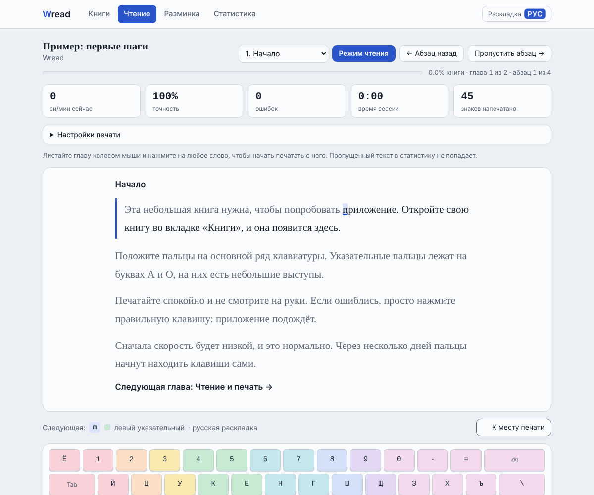

# Wread

**Читайте книги и тренируйте слепую печать одновременно.**
Откройте электронную книгу и печатайте её абзац за абзацем. Можно и просто читать в спокойном режиме без клавиатуры и меню.

*Read e-books and practice touch typing at the same time.*

👉 **Попробовать:** https://muammadgoziev-cpu.github.io/Wread/

## Возможности

- **Книги в форматах EPUB, FB2, FB2.ZIP и TXT**, в том числе старые FB2 в кодировке Windows-1251
- **Печать по тексту книги** с подсветкой следующей клавиши и пальца на экранной клавиатуре
- **Клик по любому слову**, чтобы начать печатать с него (например, пропустить предисловие)
- **Режим чтения на весь экран**: только текст, фон «Обычный», «Сепия» или «Ночь»
- **Подсказка раскладки (РУС / ENG)**: всплывает, когда нужно переключить язык
- **Статистика**: средняя скорость, точность, график по дням, карта ошибок по клавишам, самые трудные и самые медленные символы
- **Разминка**: уроки для тех, кто только учит расположение клавиш
- **Сохранение места** чтения и печати для каждой книги

## Как запустить у себя

Установка не нужна. Скачайте `index.html` и откройте его в браузере (Chrome, Edge, Firefox).

## Где хранятся данные

Всё хранится **только в вашем браузере**: книги в IndexedDB, статистика и позиции в localStorage. Ничего не отправляется на сервер. Если открыть Wread в другом браузере или на другом устройстве, данные там будут свои.

## Ограничения

- Книги с защитой от копирования (DRM) открыть нельзя.
- Пока поддерживаются только русская и английская раскладки.
- Приложение рассчитано на компьютер с физической клавиатурой.

## Технологии

Один файл HTML с CSS и JavaScript, без сборки и сервера. Для чтения EPUB используется библиотека [JSZip](https://stuk.github.io/jszip/).

## Лицензия

[MIT](LICENSE)
